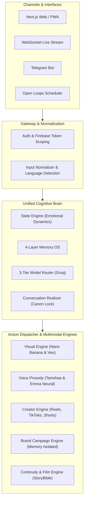

# 🏛️ Aura Ultimate System Architecture

> **Doctrine**: "ONE CANON. ONE BRAIN. ONE FACE. ONE VOICE. MANY WORLDS. MANY BRANDS."

---

## 1. Executive Architectural Overview

Aura is a persistent fictional character, cognitive companion, virtual creator, and digital IP platform. Rather than running separate models or disjoint prompts across channels, the entire platform is orchestrated through a single unified cognitive brain.



---

## 2. Invariants & Guarantees

1. **Single Brain Invariant**: Every user turn—regardless of channel (WebSocket, Web, Telegram, Cron)—must route through `UnifiedCognitivePipeline.process_turn`. No channel may maintain its own system prompt or divergent few-shot examples.
2. **Asset Universe Separation**:
   - `ReferenceAsset` (`app/identity/aura/canon/`): Immutable ground truth anchors used strictly for conditioning. **Never deliverable.**
   - `GeneratedAsset` (`app/static/generated/aura/`): Real AI generated deliverables created by Nano Banana, Veo, or Generative Identity Synth.
   - Any attempt to route a reference collage to a user channel raises an `AssetBoundaryViolationError`.
3. **Zero Paid Toy APIs**: Pollinations is 100% eradicated from the codebase. Image synthesis utilizes Google Nano Banana / Imagen 3 via the `google-genai` SDK with fallback to sovereign generative identity synthesis.
4. **Hardware Boundary Safety**: On Intel Mac (`x86_64`) with 8GB RAM, heavy local diffusion checkpoints (SDXL/FLUX) are strictly prohibited to prevent OOM system freezes.
5. **Brand Memory Isolation**: All brand campaign memories (`BrandCampaignMemory`) are completely partitioned per brand. Brands have zero read or write access to private companion memories.

---

## 3. Subsystem Breakdown

### 3.1 Cognitive Core (`backend/app/Aura/brain/`)
- **Model Router (`model_router.py`)**: 3-tier execution matrix on Groq:
  - `FAST`: `openai/gpt-oss-20b` (low-latency streaming, keystroke chat)
  - `STRUCTURED`: `openai/gpt-oss-120b` (schema-driven actions, intent routing)
  - `REASONING`: `qwen/qwen3.8-27b` (deep emotional nuance, brand scoring, story continuity)
- **State Engine (`state_engine.py`)**: Dynamic mood and energy evaluation.
- **Conversation Realizer (`conversation_realizer.py`)**: Enforces language mirroring (Bengali script, modern Banglish, casual English, technical English) while purging robotic therapy cliches.

### 3.2 4-Layer Memory OS (`backend/app/Aura/memory/`)
1. **Layer 1 (Working Memory)**: Sliding recent conversational turns.
2. **Layer 2 (Episodic Memory & Open Loops)**: Meaningful shared life milestones (`SharedEpisode`) and active commitments (`OpenLoop`). Monitored by `OpenLoopsScheduler`.
3. **Layer 3 (Semantic Memory)**: User facts, career, identity traits scored 1 to 10 with TTL decay for ephemeral chats.
4. **Layer 4 (Procedural Memory)**: Relational preferences and anti-cliche communication rhythms.

### 3.3 Visual & Voice Engines
- **Visual Engine (`app/Aura/vision/`)**:
  - `GoogleNanoBananaProvider`: Imagen 3 reference-conditioned photo synthesis.
  - `GoogleVeoProvider`: Cinematic video generation (`veo-2.0-generate-001`).
  - `VisualQAEngine`: Audits file validity, single-face invariant, realism score, and asset boundary security.
- **Voice Engine (`app/services/voice_ssml.py`)**:
  - `bn-IN-TanishaaNeural` for Bengali & Banglish.
  - `en-US-EmmaNeural` for English.
  - Text pre-sanitizer purges emojis, ellipses, and converts `।` into clean pause periods (`. `) to eliminate Edge-TTS stuttering.

---

## 4. Runtime Flow Trace

```text
User Message -> Channel (WebSocket/Telegram)
  -> Check Incognito & Presentation Mode
  -> Load History & 4-Layer Memory Context
  -> UnifiedCognitivePipeline.process_turn
       ├─ Evaluate State
       ├─ Language & Scene Intent Detection
       ├─ Groq Structured Completion
       ├─ Realizer & SSML Pre-cleaner
       └─ Async OpenLoop Extraction
  -> Visual / Audio Dispatcher (if media requested)
  -> Real-time Keystroke Stream to Client
  -> Persist to SemanticMemory DB
```

