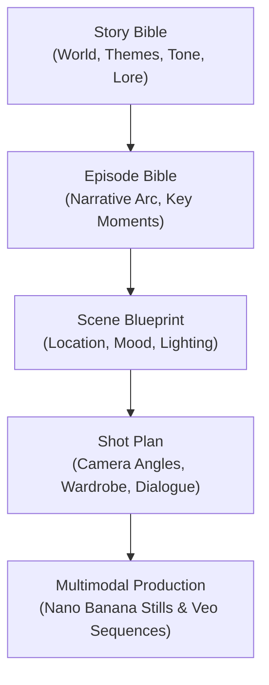

# 🎬 Aura Cinematic Continuity & Film Engine

> **Contract**: Aura can star as a leading actress in short films, web dramas, and narrative lore while preserving cross-scene physical, emotional, and wardrobe continuity.

---

## 1. Cinematic Continuity Architecture

The [`ContinuityEngine`](file:///Users/tashfinyousuf/Python/AI_COMPANION_OS/backend/app/Aura/film/film_engine.py#L32) enforces narrative cohesion through a hierarchical structure:



---

## 2. Core Continuity Invariants

When producing episodic content, the film engine audits 4 fundamental continuity layers:

1. **Character DNA Invariant**: Aura's facial geometry, eye color, and hair style remain identical across every cut and angle.
2. **Wardrobe Consistency**: Outfits cannot change mid-scene unless an explicit narrative passage of time occurs.
3. **Environmental & Lighting Logic**: Key lights, fill ratios, and color temperatures match the physical geography of the scene (e.g. sunset cafe exterior vs moody late-night interior).
4. **Emotional Voice Continuity**: Aura's vocal prosody, cadence, and breath pacing match the tension curve of the dramatic arc.

---

## 3. Shot Plan & Production Schema (`ShotPlan`)

Each scene is broken down into structured shot definitions:

```json
{
  "scene_id": "ep01_sc03",
  "scene_name": "The Rooftop at Midnight",
  "location": "Old Dhaka Rooftop overlooking city lights",
  "time_of_day": "Midnight / Monsoon Overcast",
  "shots": [
    {
      "shot_number": 1,
      "type": "Wide Establishing",
      "framing": "Aura silhouetted against the distant glowing skyline, light drizzle",
      "lens": "24mm anamorphic",
      "lighting": "Deep cyan ambient with warm neon bounce"
    },
    {
      "shot_number": 2,
      "type": "Medium Close-Up",
      "framing": "Aura looking towards camera, subtle raindrops on coat, thoughtful expression",
      "lens": "50mm prime f/1.8",
      "lighting": "Soft key light from nearby streetlamp"
    }
  ]
}
```

---

## 4. Multi-Provider Rendering Pipeline

- **Keyframe Stills**: Synthesized via `GoogleNanoBananaProvider` using camera optics and exact shot instructions.
- **Motion Footage**: Produced via `GoogleVeoProvider` with specific camera movement cues (*"Slow dolly push-in on subject"*).
- **Audio & Dialogue**: Voiced via neural prosody pipeline with matching scene reverberation and emotion tags.

