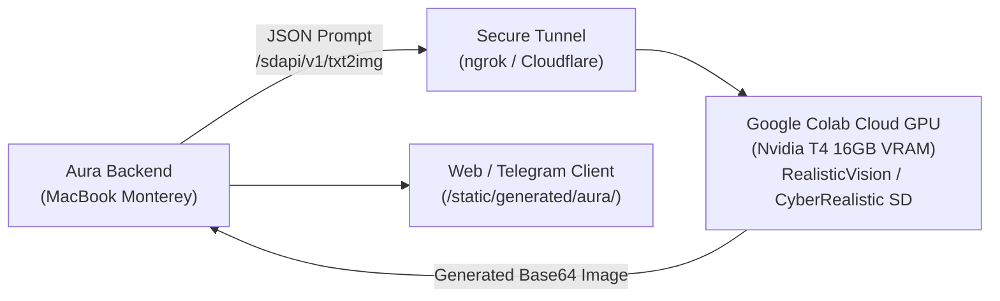

# ☁️ Google Colab Cloud Stable Diffusion Setup Guide for Aura

> **Purpose**: Enables high-fidelity, uncensored photorealistic portrait and intimate/boudoir image synthesis on a **free cloud GPU (Google Colab T4)** without putting any memory load on your local MacBook (Monterey series, 8GB RAM).

---

## 1. Why Remote Cloud Stable Diffusion?

- **Local Machine Constraints**: An Intel Mac (`x86_64`) with 8GB RAM cannot run local SD 1.5/SDXL diffusion without encountering Out-Of-Memory (OOM) kernel panics and freezing.
- **The Solution**: Run Stable Diffusion WebUI / Forge / FastAPI SD on Google Colab's free 16GB VRAM Nvidia T4 GPU, expose a secure tunnel (ngrok / Cloudflare), and connect Aura directly via the `SD_REMOTE_URL` environment variable.



---

## 2. Google Colab 1-Click Setup (Quickstart)

### Step 1: Open Google Colab
1. Go to [colab.research.google.com](https://colab.research.google.com).
2. Create a **New Notebook**.
3. In the menu, go to **Runtime** > **Change runtime type** > Select **T4 GPU** > Click **Save**.

### Step 2: Paste and Run the Server Script
Paste the following code into the first cell of your Google Colab notebook:

```python
# ============================================================
# AURA REMOTE STABLE DIFFUSION CLOUD WORKER
# ============================================================
!pip install -q diffusers transformers accelerate torch safetensors pyngrok

import os
import torch
import base64
from io import BytesIO
from fastapi import FastAPI
from pydantic import BaseModel
import uvicorn
from pyngrok import ngrok
from diffusers import StableDiffusionPipeline, DPMSolverMultistepScheduler

# 1. Load Model (Realistic Vision v5.1 for authentic human skin & facial anatomy)
model_id = "SG161222/Realistic_Vision_V5.1_noVAE"
print("⏳ Loading model into Colab GPU...")
pipe = StableDiffusionPipeline.from_pretrained(
    model_id, 
    torch_dtype=torch.float16,
    safety_checker=None  # Uncensored intimate & sensual roleplay capability
)
pipe.scheduler = DPMSolverMultistepScheduler.from_config(pipe.scheduler.config)
pipe.to("cuda")
print("✅ Model loaded successfully on GPU!")

# 2. Setup FastAPI Server
app = FastAPI(title="Aura SD Cloud Endpoint")

class Txt2ImgRequest(BaseModel):
    prompt: str
    negative_prompt: str = ""
    steps: int = 25
    width: int = 768
    height: int = 1024
    cfg_scale: float = 7.0

@app.get("/sdapi/v1/options")
def check_status():
    return {"status": "online", "model": model_id, "gpu": torch.cuda.get_device_name(0)}

@app.post("/sdapi/v1/txt2img")
def generate_image(req: Txt2ImgRequest):
    image = pipe(
        prompt=req.prompt,
        negative_prompt=req.negative_prompt,
        num_inference_steps=req.steps,
        guidance_scale=req.cfg_scale,
        width=req.width,
        height=req.height
    ).images[0]
    
    buffered = BytesIO()
    image.save(buffered, format="JPEG", quality=95)
    img_b64 = base64.b64encode(buffered.getvalue()).decode("utf-8")
    return {"images": [img_b64]}

# 3. Tunnel with Ngrok or Cloudflare
# (Get your free authtoken at dashboard.ngrok.com)
NGROK_TOKEN = "YOUR_NGROK_AUTHTOKEN_HERE"
if NGROK_TOKEN != "YOUR_NGROK_AUTHTOKEN_HERE":
    ngrok.set_auth_token(NGROK_TOKEN)

public_tunnel = ngrok.connect(8000)
print("\n" + "="*60)
print(f"🔥 AURA SD REMOTE URL: {public_tunnel.public_url}")
print("="*60 + "\n")

# Start Server
import nest_asyncio
nest_asyncio.apply()
uvicorn.run(app, host="0.0.0.0", port=8000)
```

### Step 3: Connect to Aura
1. Copy the printed tunnel URL (e.g. `https://xxxx-xx-xx.ngrok-free.app`).
2. Add it to your `.env` file in `AI_COMPANION_OS`:
   ```bash
   SD_REMOTE_URL=https://xxxx-xx-xx.ngrok-free.app
   ```
3. Restart or reload your Aura backend.
4. Now, whenever an intimate selfie or adult photo is requested in Adult Mode, Aura will generate high-fidelity, uncensored photorealistic images directly on the Colab GPU!

---

## 3. Automatic Fallback Architecture

If your Google Colab notebook is paused or offline:
- Aura's [`ImageEngine`](file:///Users/tashfinyousuf/Python/AI_COMPANION_OS/backend/app/Aura/vision/image_engine.py#L156) automatically and gracefully falls back to Google Nano Banana / Imagen 3 or the sovereign reference synthesizer with boudoir/bedroom lighting.
- The chat, voice notes, and roleplay will **never freeze, crash, or fail**.

