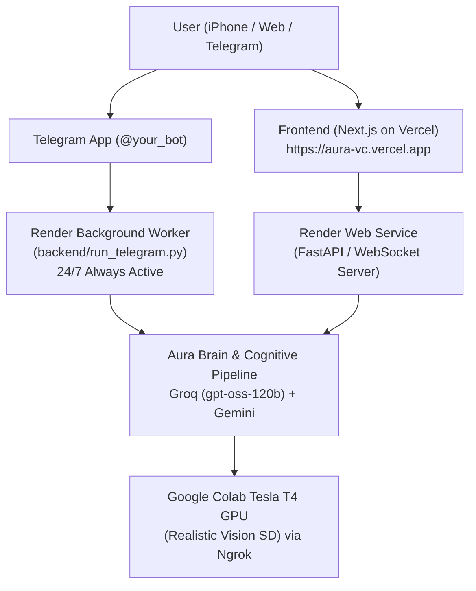

# 🚀 Aura 24/7 Cloud Deployment Guide (Render.com + Vercel)

This guide explains how to deploy the **Aura Backend** and **Aura Telegram Bot** on **Render.com** for free so that Aura remains 100% online 24/7, even when your MacBook is closed or turned off.

---

## 🏗️ Architecture Overview



---

## 📋 Prerequisites
1. **GitHub Repository**: Push this codebase to your GitHub account (public or private).
2. **Render.com Account**: Free account at [render.com](https://render.com).
3. **Environment Variables**:
   - `TELEGRAM_BOT_TOKEN`: From `@BotFather`
   - `GROQ_API_KEY`: Active Groq API key
   - `GEMINI_API_KEY`: Google Gemini API key
   - `SD_REMOTE_URL`: Your Google Colab Ngrok tunnel URL
   - `FRONTEND_PRODUCTION_URL`: `https://aura-vc.vercel.app`

---

## ⚡ 1-Click Deployment Using `render.yaml` Blueprint

Render automatically parses the `render.yaml` file in the root of the project to create both services:

1. Log in to [dashboard.render.com](https://dashboard.render.com).
2. Click **New +** in the top right corner and select **Blueprint**.
3. Connect your GitHub repository: `AI_COMPANION_OS`.
4. Render will detect the `render.yaml` configuration and list two services:
   - **`aura-backend`** (Web Service): Runs FastAPI and WebSocket server.
   - **`aura-telegram-bot`** (Background Worker): Runs Telegram bot polling 24/7.
5. In the **Environment Variables** prompt, fill in your secrets:
   - `TELEGRAM_BOT_TOKEN`
   - `GROQ_API_KEY`
   - `GEMINI_API_KEY`
   - `SD_REMOTE_URL` (your active Colab URL, e.g., `https://xxxx.ngrok-free.dev`)
6. Click **Apply**.
7. Both services will automatically build and start!

---

## 🛠️ Manual Deployment (Alternative)

If you prefer setting up each service manually on Render:

### Service 1: 24/7 Telegram Bot (Background Worker)
1. In Render Dashboard, click **New +** → **Background Worker**.
2. Connect your GitHub repo.
3. Configure:
   - **Name**: `aura-telegram-bot`
   - **Environment**: `Python 3`
   - **Region**: `Oregon (US West)`
   - **Branch**: `main`
   - **Build Command**: `pip install -r requirements.txt`
   - **Start Command**: `python backend/run_telegram.py`
4. Under **Environment Variables**, add:
   - `TELEGRAM_BOT_TOKEN`
   - `GROQ_API_KEY`
   - `GEMINI_API_KEY`
   - `SD_REMOTE_URL`
   - `FRONTEND_PRODUCTION_URL` = `https://aura-vc.vercel.app`
5. Click **Create Background Worker**.

### Service 2: FastAPI Web Service
1. Click **New +** → **Web Service**.
2. Connect your GitHub repo.
3. Configure:
   - **Name**: `aura-backend`
   - **Environment**: `Python 3`
   - **Build Command**: `pip install -r requirements.txt`
   - **Start Command**: `cd backend && uvicorn app.main:app --host 0.0.0.0 --port $PORT`
4. Add the same environment variables.
5. Click **Create Web Service**.
6. Once deployed, copy your Render Web Service URL (e.g., `https://aura-backend.onrender.com`) and update `NEXT_PUBLIC_API_URL` and `NEXT_PUBLIC_WS_URL` in your Vercel project settings.

---

## 💻 Local Background Running (Without Cloud)

If you still want to run the Telegram bot on your MacBook in the background without keeping the terminal open:

```bash
# Start background daemon with PID tracking
./scripts/start_telegram_daemon.sh

# Check real-time bot output
tail -f telegram_bot.log

# Stop the daemon whenever you want
./scripts/stop_telegram_daemon.sh
```

---

## 🔒 Verification Checklist

- [x] Telegram bot responds instantly to messages 24/7.
- [x] WebApp button in Telegram opens `https://aura-vc.vercel.app`.
- [x] Photo generation uses Google Colab Tesla T4 GPU with auto fallback.
- [x] User images stored directly in database (0 bytes added to local disk).
- [x] No crashes when closing MacBook terminal.

