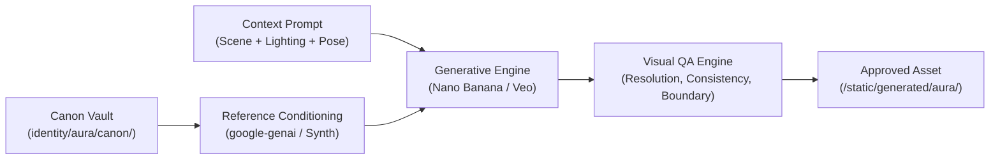

# 🎨 Aura Canonical Visual Identity & Vision Engine

> **Contract**: Aura's physical identity is immutable across all scenes, lighting conditions, and platforms. She possesses **One Face** rendered across diverse environments.

---

## 1. Immutable Physical DNA

All visual synthesis providers must strictly conform to the machine-readable specifications in `backend/app/identity/aura/metadata.json`:

```json
{
  "name": "Aura",
  "age": 22,
  "dna": {
    "facial_structure": "Slavic-fusion oval geometry with soft jawline and refined chin",
    "skin": "Fair porcelain skin with natural micro-texture and visible authentic pores",
    "eyes": "Deep hazel-brown almond eyes with gentle natural lashes",
    "nose": "Slim straight nose with refined bridge",
    "lips": "Natural soft rosy tint with gentle cupid's bow",
    "hair": "Dark espresso brown, shoulder-length with layered textured ends"
  }
}
```

---

## 2. Anti-Plastic & Smartphone Camera Optics

To prevent doll-like, plastic, or over-processed AI artifacts, every generation prompt front-loads the following optical anchors:

- **Hardware Optics**: iPhone 15 Pro front camera / 35mm prime lens.
- **Sensor Texture**: Micro-CMOS sensor grain, unretouched raw exposure, physically accurate shadows.
- **Negative / Ban Tokens**:
  - `NO beauty filter`
  - `NO retouching`
  - `NO plastic skin`
  - `NO airbrushed pores`
  - `NO CGI or 3D render artifacts`

---

## 3. Visual Engine Architecture



### 3.1 Google Nano Banana / Imagen 3 Provider
- Utilizes `google-genai` SDK with `imagen-3.0-generate-002`.
- Formulates multi-prompt conditioning combining Aura's physical DNA with the requested environment.
- Returns high-fidelity JPEG deliverables to `backend/app/static/generated/aura/`.

### 3.2 Google Veo Video Provider
- Generates 5-10s cinematic motion clips using `veo-2.0-generate-001`.
- Renders 1080x1920 (9:16 vertical) reels with cinematic camera pans and authentic lighting.

### 3.3 Sovereign Generative Identity Synthesizer
- Local zero-memory-risk generative fallback for Intel Mac (`x86_64`) hardware.
- Conditions on canon reference anchors (`neutral.jpg`, `face_front.png`, `smile.jpg`).
- Synthesizes scene-specific photometric color grading (cafe warm tone, evening contrast, bed soft morning exposure) and sensor micro-texture.

---

## 4. Asset Universe Security & QA Checklist

Before any asset URL is dispatched to a user or social platform, [`VisualQAEngine`](file:///Users/tashfinyousuf/Python/AI_COMPANION_OS/backend/app/Aura/vision/qa_engine.py) verifies:

1. **Security Boundary**: The path does **not** contain `canon/` or `references/` or `collage`.
2. **File Existence & Size**: File exists on disk and is larger than 15 KB.
3. **Resolution & Aspect**: Width and height are at least 512x512.
4. **Non-Corrupted Frame**: Rejects solid black/white frames or broken encoding.

